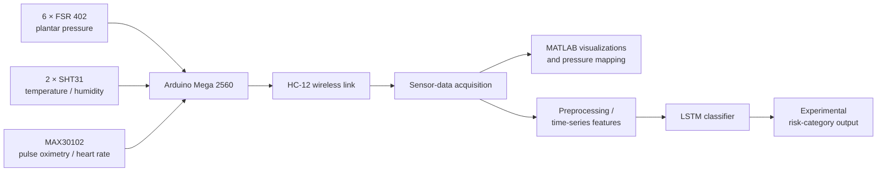

# Wearable Smart Insole for Early Diabetic Foot Ulcer Prediction Using Multi-Modal Sensing

**Bachelor's Thesis / Final-Year Project · BSc Electrical Engineering · Information Technology University of the Punjab (ITU), Lahore · 2025**

**Authors:** Muhammad Nouman and Abdul Rahman  
**Supervisor:** Prof. Dr. Qasim Mehmood  
**Co-supervisor:** Dr. Sadia Noureen  
**Publication:** [IEEE INMIC 2025](https://doi.org/10.1109/INMIC65900.2025.11348422) · DOI: [10.1109/INMIC65900.2025.11348422](https://doi.org/10.1109/INMIC65900.2025.11348422)

## Overview

Diabetic foot ulcers can be associated with abnormal plantar loading and changes in local physiological conditions. Our final-year project investigated a **wearable multimodal smart-insole prototype** for collecting and visualizing relevant sensor measurements and assessing patterns in time-series data with machine learning.

The prototype combines pressure and physiological sensors, microcontroller-based data acquisition, wireless transmission, MATLAB visualization, and an experimental Long Short-Term Memory (LSTM) classification workflow. The work brings together **embedded electronics, biomedical sensing, signal processing, and applied machine learning**.

## System architecture

### Prototype components

| Component | Purpose |
| --- | --- |
| FSR 402 force-sensitive resistors (6) | Measure plantar pressure at selected locations |
| SHT31 sensors (2) | Measure local temperature and humidity |
| MAX30102 | Record pulse-oximetry and heart-rate signals |
| Arduino Mega 2560 | Collect sensor readings |
| HC-12 radio modules | Transmit readings to the receiving system |
| MATLAB | Real-time sensor visualization and pressure mapping |
| Python / TensorFlow | LSTM-based experimental analysis |
| Custom enclosure and insole assembly | Package the wearable electronics |

The component configuration above follows the **published IEEE INMIC paper**. Different design iterations may be described in earlier project notes.

## Machine-learning approach

The bachelor's thesis (Chapter 6) describes a time-series classification pipeline:

1. Acquire sensor readings and arrange measurements in CSV-formatted time series.
2. Normalize inputs, calculate descriptive temporal features, and address reported class imbalance with augmentation.
3. Train an LSTM network with two 128-unit recurrent layers, dropout, and a dense classification head.
4. Evaluate on the reported **70% training / 15% validation / 15% testing** split using accuracy, precision, recall, F1 score, and a confusion matrix.

**Reported results (not independently reproduced in this repository):**

| Evaluation | Result as reported |
| --- | --- |
| Study participants | 22 volunteers (IEEE INMIC paper) |
| Thesis-reported test accuracy | 92% (bachelor's thesis, §6.6) |
| Thesis-reported high-risk precision / recall | 89% / 87% (bachelor's thesis, §6.6) |
| Conference paper's LSTM classification result | 94–96% (IEEE INMIC paper, §4.4) |

These figures come from different sections/documents; they **should not be treated as directly equivalent benchmark runs**. Source code, evaluation splits, label definitions, and the precise experimental protocol need to be checked before stronger reproducibility claims are made. The project has not established clinical diagnostic accuracy or prospective prediction of future ulceration.

## Research outputs

| Material | Availability |
| --- | --- |
| **Bachelor's thesis (PDF)** | Approved for sharing; [upload pending in `docs/`](docs/) |
| **Final-year-project poster (PDF)** | Approved for sharing; [upload pending in `docs/`](docs/) |
| **IEEE INMIC 2025 paper** | [Publisher record and DOI](https://doi.org/10.1109/INMIC65900.2025.11348422) |
| Prototype photographs and result plots | [Selected images to be uploaded in `Hardware-Images/`](Hardware-Images/) |
| 3D-printed enclosure and CAD/STL models | [Public hardware files to be uploaded in `Hardware_Files/`](Hardware_Files/) |
| Python, MATLAB, and microcontroller source code | **Private — not being released** |
| Trained model/checkpoints | **Private — not being released** |
| Participant-level/raw biomedical data | **Not publicly released** |

This repository is a **research documentation and hardware-design portfolio** rather than a fully reproducible software release. It will include approved thesis documents, hardware assets, and selected non-identifying result figures. Source code and underlying datasets will not be shared. For uploading instructions, see [UPLOAD_CHECKLIST.md](UPLOAD_CHECKLIST.md).

## Limitations and responsible use

- The participant study was limited in size; there is no documented large-scale, independent clinical validation.
- Classification metrics should not be interpreted as reliable clinical screening performance.
- Sensor readings can depend on placement, motion, calibration, and participant characteristics.
- To protect research participants and comply with the chosen sharing scope, **all raw data, trained models and source code are excluded from public release**.
- The published conference article is linked via its official DOI instead of uploading an unlicensed publisher PDF.

## Citation

Muhammad Nouman and Abdul Rahman, **“Wearable Smart Insole for Early Diabetic Foot Ulcer Prediction Using Multi-Modal Sensing,”** *2025 27th International Multitopic Conference (INMIC)*, IEEE, 2025. https://doi.org/10.1109/INMIC65900.2025.11348422

## Acknowledgments

This final-year project was carried out at the **Department of Electrical Engineering, Information Technology University of the Punjab**, with the guidance of Prof. Dr. Muhammad Qasim Mehmood and Dr. Sadia Noureen. The IEEE publication notes equal contributions from both authors.

---

**Contact:** [Muhammad Nouman](https://github.com/MuhammadNoumanAmanat) · [ORCID](https://orcid.org/0009-0008-6085-4282)
